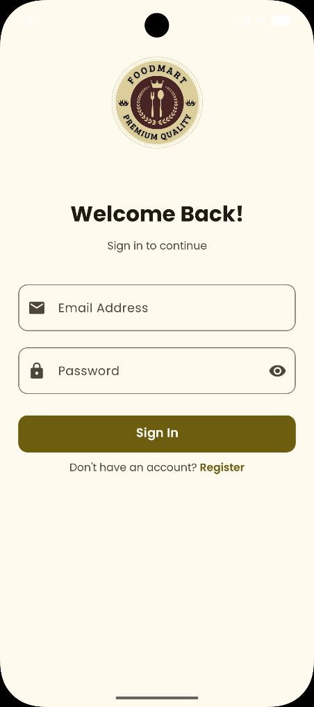
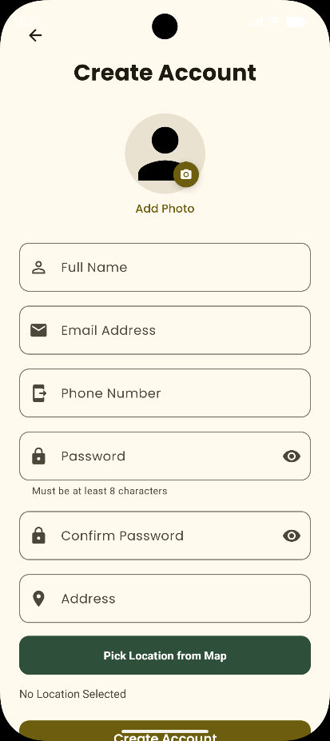
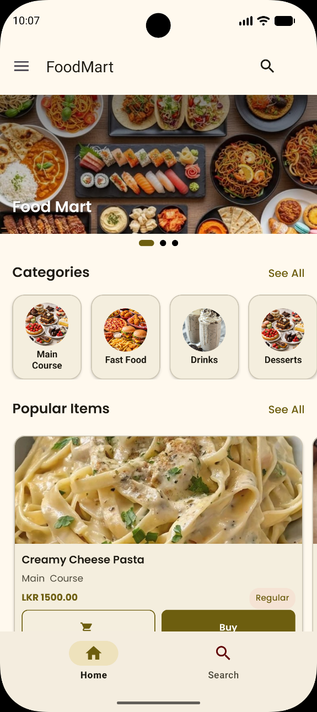
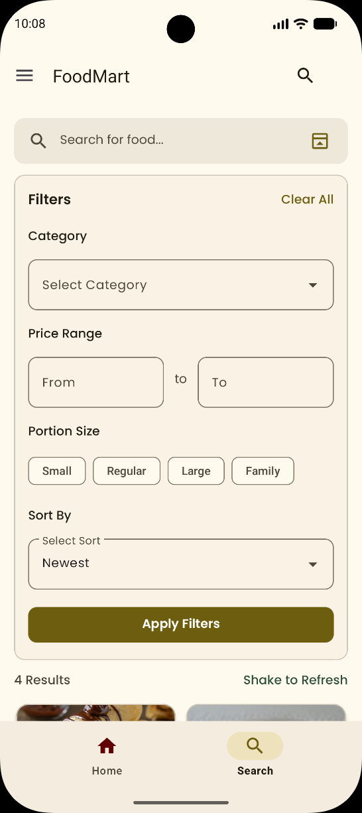
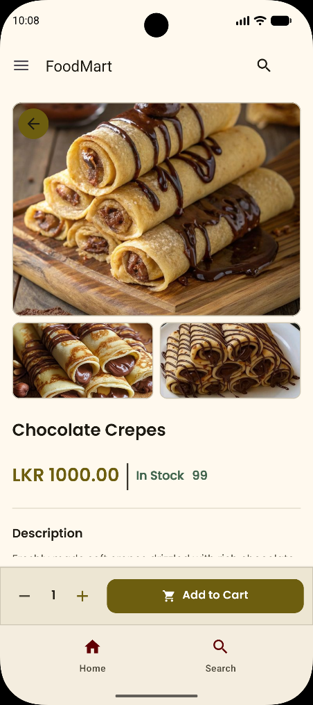
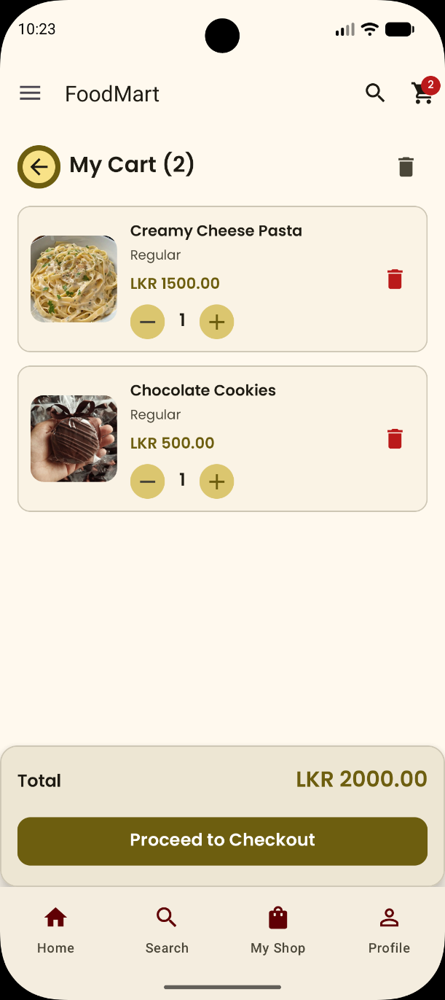
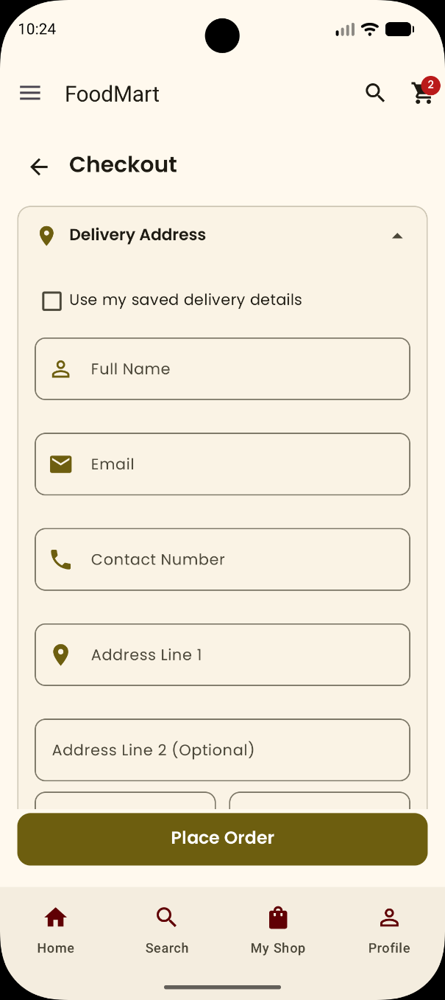
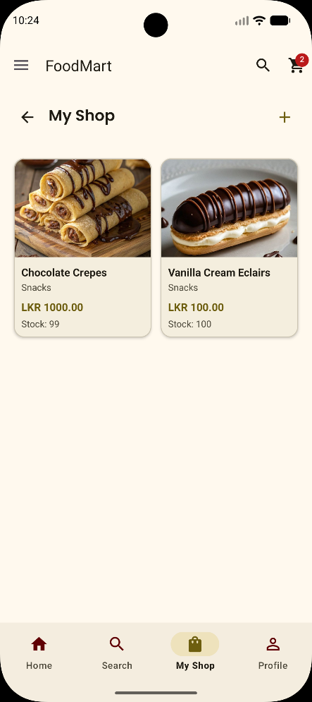
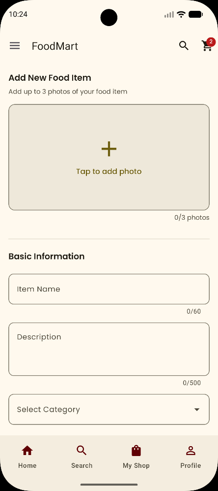
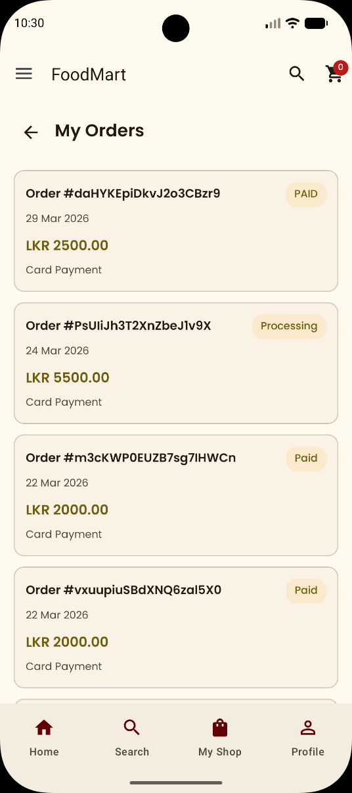

# 🍽️ FoodMart

[](https://github.com/YOUR_USERNAME/FoodMart/actions/workflows/android-build.yml)


FoodMart is an Android marketplace app for home cooks and small food sellers. A single account can act as **both buyer and seller**: list your own food items, browse and order from others, and discover nearby sellers on a map.

Built as the final project for *Handheld Device Programming II* (BSc (Hons) Software Engineering, Java Institute for Advanced Technology).

## ✨ Features

- **Authentication**: register and sign in with Firebase Authentication; profile photo upload; location-assisted address entry with Google Maps.
- **Discovery**: home screen with banners, categories and popular items; search with category, price range, portion size and sort filters; *shake to refresh* using the accelerometer.
- **Product details**: image gallery, stock, description, seller info, and a one-tap call to the seller.
- **Cart and checkout**: quantity management, saved delivery details, and online card payment through the PayHere sandbox.
- **Orders**: buyer order history with status, and order detail view.
- **Seller tools**: *My Shop* inventory, add and edit items with up to 3 photos, stock and portion sizes, and seller order management.
- **Nearby sellers**: find sellers around you on Google Maps.
- **Notifications**: background reminders for sellers about pending orders (WorkManager and a broadcast receiver).

## 📱 Screenshots

| Login | Register | Home |
|:--:|:--:|:--:|
|  |  |  |

| Search & Filters | Product Details | Cart |
|:--:|:--:|:--:|
|  |  |  |

| Checkout | My Shop | Add Item |
|:--:|:--:|:--:|
|  |  |  |

| My Orders |
|:--:|
|  |

## 🛠️ Tech Stack

| Area | Technology |
|---|---|
| Language | Java 11 |
| UI | Android Views, ViewBinding, Material Components, Fragments |
| Backend | Firebase Authentication, Cloud Firestore, Firebase Storage |
| Maps and location | Google Maps SDK, Fused Location Provider |
| Payments | PayHere Android SDK (sandbox) |
| Images | Glide, Picasso |
| Background work | WorkManager, BroadcastReceiver |
| Other | Gson, Lombok, SharedPreferences, DotsIndicator |
| Build | Gradle (version catalog), GitHub Actions CI |

## 🗂️ Project Structure

```
app/src/main/java/lk/sa/foodmart/
├── activity/     # Splash, Login, Registration, Main, Maps
├── fragment/     # Home, Search, Cart, Checkout, Orders, Profile, Seller screens
├── adapter/      # RecyclerView / ViewPager adapters
├── model/        # User, FoodItem, Order, CartItem, ...
├── preference/   # SharedPreferences helpers
├── reciever/     # Notification broadcast receiver
└── worker/       # WorkManager seller order reminders
```

## 🚀 Getting Started

### Prerequisites
- Android Studio (latest stable) and JDK 17
- A Firebase project (Authentication, Firestore, Storage enabled)
- A Google Maps API key
- *(Optional)* a PayHere sandbox merchant account for payments

### Setup

1. **Clone the repo**
   ```bash
   git clone https://github.com/YOUR_USERNAME/FoodMart.git
   ```
2. **Firebase**: register an Android app with package name `lk.sa.foodmart`, download `google-services.json` and place it in `app/`. (See `app/google-services.json.example` for the expected shape.)
3. **API keys**: add the following to `local.properties` (this file is git-ignored):
   ```properties
   MAPS_API_KEY=your_google_maps_api_key
   PAYHERE_MERCHANT_ID=your_payhere_sandbox_merchant_id
   PAYHERE_MERCHANT_SECRET=your_payhere_sandbox_merchant_secret
   ```
   Placeholders in `local.defaults.properties` let the project compile without them, but maps and payments will not work.
4. **Run**: open the project in Android Studio, sync Gradle and run on a device or emulator (minSdk 28).

> **Security note:** never commit `google-services.json` or `local.properties`. Restrict your API keys to this app's package name and SHA-1 in the Google Cloud console.

## 🔮 Future Improvements

- Migrate to MVVM with a repository layer
- Add unit and UI tests
- Real-time order status updates with push notifications
- Seller ratings and reviews
- Kotlin and Jetpack Compose migration

## 📄 License

Released under the [MIT License](LICENSE).

## 👤 Author

**Shivoni Amasha**: [GitHub](https://github.com/YOUR_USERNAME)
